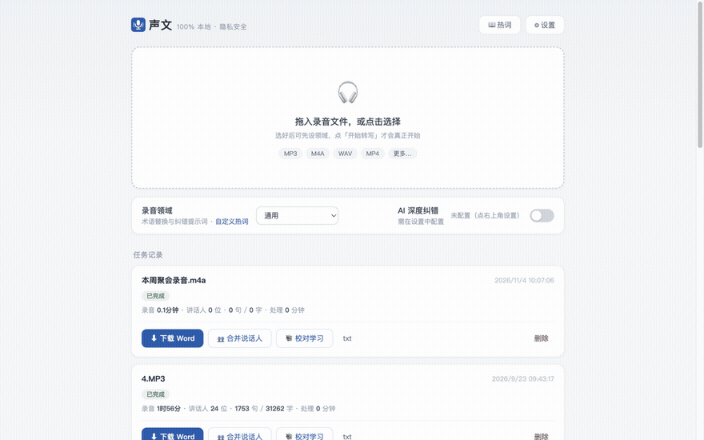
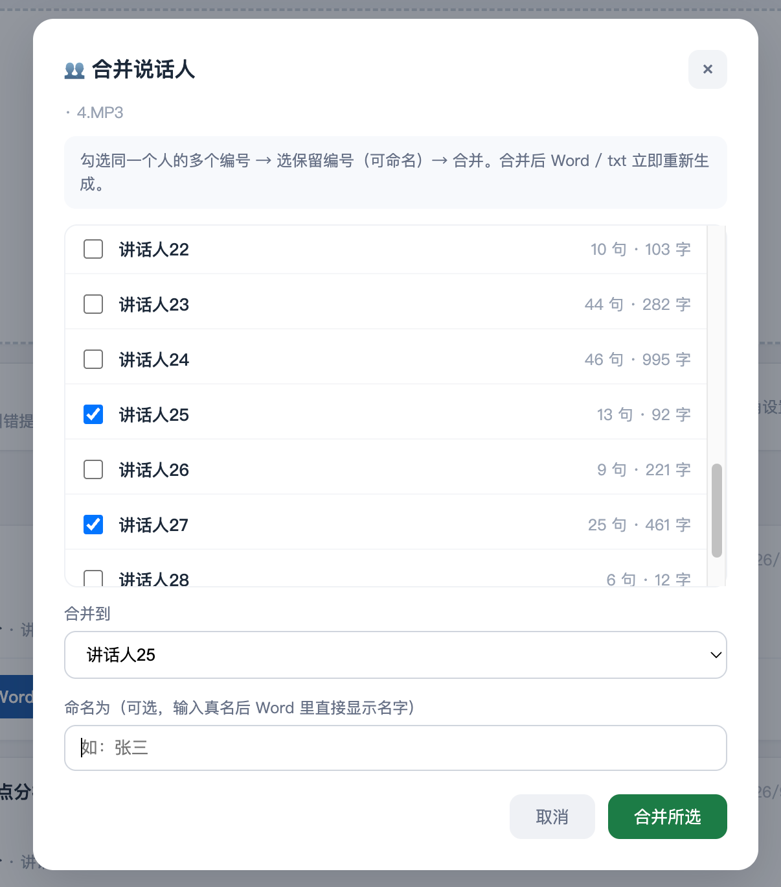

# ShengWen (声文)

> "Sound becomes text" — a 100% local Chinese speech-to-text web app for Mac.

[简体中文](README.md) | English

Recording in, speaker-labelled Word document out. Nothing ever leaves your machine.



| Upload: just drop a file | Review: merge speakers, set real names |
|---|---|
|  |  |

## Why

The existing options for Chinese transcription:

- **Cloud services** (iFlytek etc.): accurate, but billed by the minute — and your recordings are uploaded to someone else's server. A deal-breaker for interviews, meetings and research material with real names in them.
- **Open-source tools** (Whisper family): free and local, but Chinese accuracy is poor — homophone errors everywhere, proofreading takes longer than typing.

**ShengWen** runs [MOSS-Transcribe-Diarize](https://github.com/OpenMOSS/MOSS-Transcribe-Diarize) (open-sourced by Fudan's OpenMOSS team) locally on an Apple Silicon Mac, and gets accuracy close to paid cloud transcription — with the recording never leaving your computer.

## How it compares

| | ShengWen | MacWhisper | Cloud transcription (iFlytek FeiZhi, etc.) |
|---|---|---|---|
| Cost | Free, open source (MIT) | Free tier + paid Pro | Billed by minute/hour |
| Where recordings go | Your machine | Your machine | Vendor's server |
| Chinese accuracy | **CER ≈ 10.5%** (vs. proofread transcript) | Whisper-based (not independently tested) | High |
| Speaker diarization | End-to-end, built in + manual merge | Yes (beta) | Yes |
| Usage | Drop files in a browser | Drag in / record in app | Upload to web/app |
| Platform | Apple Silicon Mac | Apple Silicon Mac | Any (online) |

> The MacWhisper column reflects publicly available product information; we have not benchmarked it ourselves.

## Benchmarks

Measured on a 116-minute real meeting recording, using a paid cloud transcript (human-proofread level) as the reference:

| Metric | ShengWen (MOSS) |
|---|---|
| Character Error Rate | **≈ 10.5%** |
| Key term accuracy | **100%+** — a few terms the paid transcript got wrong were recognized correctly |

## Features

- 🎯 **High Chinese accuracy** — proper nouns recognized natively, no configuration needed
- 👥 **Speaker diarization** — end-to-end separation; merge labels and assign real names in the web UI
- 🔒 **100% local** — recordings never leave the machine
- ⚡ **MPS GPU acceleration** — ~4× faster than CPU on Apple Silicon; a 2-hour recording finishes in ~25 minutes
- 📄 **Multiple exports** — Word (grouped by speaker) / txt / srt / json
- 🔄 **Resumable** — long audio is processed in segments; interrupted jobs skip completed segments on rerun
- 📚 **Hotwords + proofreading loop** — maintain per-domain correction lists; upload your proofread Word file and it learns your corrections automatically
- 🧩 **Optional AI polish** — connect any OpenAI-compatible API (DeepSeek, GLM, Kimi…) to fix homophone errors; works fine without it

## Requirements

- **Apple Silicon Mac** (M1/M2/M3/M4), 16 GB+ memory recommended
- macOS 12+
- [FFmpeg](https://ffmpeg.org) (`brew install ffmpeg`)
- Internet access on first install (GitHub + HuggingFace, or their mirrors)

## Quick start

**Option A — zip package (no git needed):**

1. Download `shengwen-transcribe-v*.zip` from [Releases](https://github.com/yunfeng008/shengwen-transcribe/releases)
2. Unzip (Finder double-click), open the folder
3. Double-click `install.command` → wait ~10 minutes (downloads the 1.7 GB model; falls back to the hf-mirror.com mirror automatically if the official source fails)
4. Double-click `start.command` → your browser opens

**Option B — git:**

```bash
git clone https://github.com/yunfeng008/shengwen-transcribe.git
cd shengwen-transcribe
./install.sh && ./start.command
```

A standalone model package (`shengwen-models-v*.tar.gz`) is also available on Releases if you prefer to skip the download step.

> **Blocked on first launch?** If macOS says the app "cannot be verified" when you double-click `install.command` / `start.command`, the file isn't broken — it's Gatekeeper blocking unsigned apps. Right-click the file → **Open** → **Open** again; or open **System Settings → Privacy & Security** and click **Open Anyway**.

Want a quick sanity check after installing? Grab this [30-second sample audio](docs/sample-audio.mp3) (a synthetic meeting intro generated with macOS TTS, no private content) and drop it in; the [sample transcript](docs/sample-transcript.docx) is its actual output.

## AI polish (optional)

Enter any OpenAI-compatible API key in Settings (DeepSeek / GLM / Kimi etc.). After transcription, one click fixes homophone errors and terminology. Fully optional — everything works without it.

## How it works

```
audio → FFmpeg 16 kHz wav → segmentation (10 min/segment, 30 s overlap)
  → MOSS per-segment inference (transcription + in-segment diarization, MPS fp16)
  → cross-segment speaker alignment → hotword replacement → text smoothing
  → [optional] LLM polish → Word / txt / srt / json
```

Each completed segment is checkpointed immediately (resumable); the model stays resident between jobs.

## Performance (M1 Max)

| Recording length | Processing time |
|---|---|
| 30 min | ~6 min |
| 2 h | ~25 min |

## FAQ

**Windows / Intel Mac?**
Not supported. MPS acceleration and the runtime are Apple Silicon specific. A CPU-only cross-platform port is theoretically possible but untested.

**Why are there more speaker labels than actual people?**
Cross-segment speaker IDs over-split on long recordings — a limitation of current end-to-end approaches. Acoustic embedding matching (CAM++/ECAPA) tops out around 47–60% same-speaker accuracy on far-field recordings, which is why this project uses text-overlap alignment plus a manual merge UI. Tidying up usually takes a few minutes.

**It misheard something. How do I fix it?**
Two ways: ① add a `wrong=>right` rule in Settings → Hotwords; ② proofread in Word and upload the corrected file via the task's "learn from proofread" action — rules are extracted automatically, and recordings in the same domain get more accurate over time.

**How close is it to paid cloud transcription?**
Text accuracy is nearly on par (key terms 100%+). Speaker separation needs a small amount of manual merging. In exchange: zero cost and complete privacy.

See [PRODUCT.md](PRODUCT.md) for technical details (Chinese).

## Roadmap

- Windows / CPU-only cross-platform: under evaluation
- Live recording, post-meeting AI summary & action items: gathering requirements — issues welcome
- Maintained as a personal project driven by real usage; no timeline promises

## License

This app's code is released under the [MIT License](LICENSE) (Copyright © 2026 dyunfeng).

Bundled third-party components keep their own licenses:
- [MOSS-Transcribe-Diarize](https://github.com/OpenMOSS/MOSS-Transcribe-Diarize) (transcription engine): Apache-2.0
- [Whisper-Medium](https://github.com/openai/whisper) (encoder): MIT
- [Qwen3-0.6B](https://huggingface.co/Qwen/Qwen3-0.6B) (decoder): Apache-2.0

## Acknowledgements

- [OpenMOSS](https://github.com/OpenMOSS) — the MOSS-Transcribe-Diarize model
- [ModelScope](https://modelscope.cn) — model distribution
- [Apple ML](https://developer.apple.com/machine-learning/) — MPS inference acceleration
