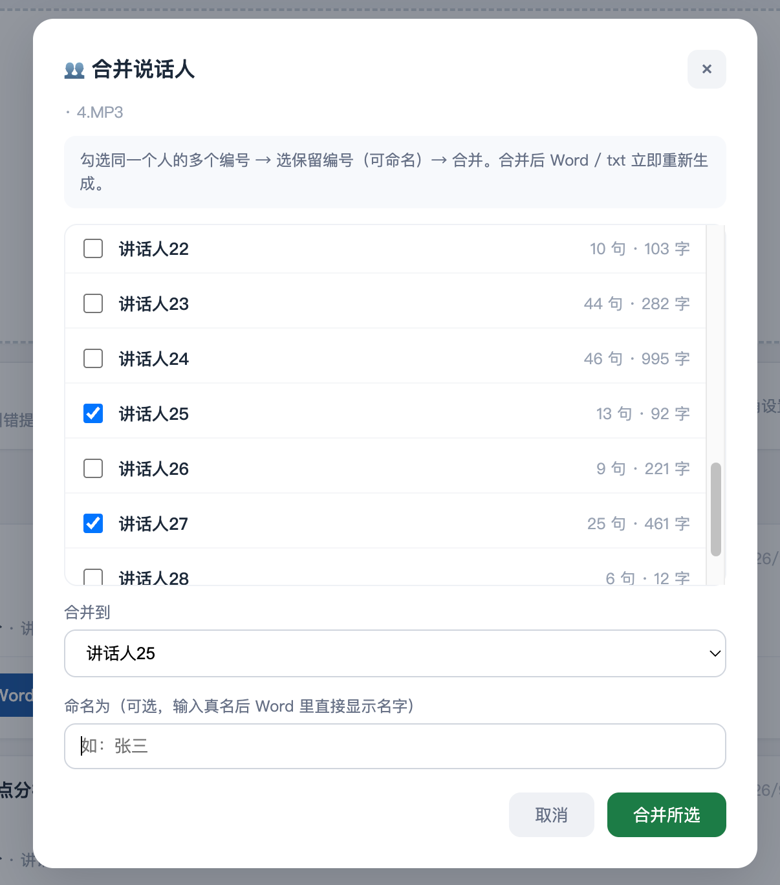

# 声文 ShengWen

> 声音成文 —— 中文录音本地转写工具。把录音变成带说话人的 Word 文档，全程不联网。

简体中文 | [English](README.en.md)

**English**: ShengWen ("sound becomes text") — a 100% local Chinese speech-to-text web app for Mac. Recording in, speaker-labelled Word document out. Built on [MOSS-Transcribe-Diarize](https://github.com/OpenMOSS/MOSS-Transcribe-Diarize) with Apple MPS acceleration.


| 上传界面：拖入录音即可 | 校对：说话人合并与真名命名 |
|---|---|
|  |  |

## 为什么做这个

市面上的中文转写方案：云端服务（讯飞等）按小时收费且要上传录音；开源工具（Whisper 系）中文准确率不理想。**声文**用复旦开源的 MOSS-Transcribe-Diarize 模型，在 Mac 上本地跑出接近讯飞的中文准确率——录音永远不离开你的电脑。

| | 声文 | MacWhisper | 云端转写（讯飞听见/飞书妙记等） |
|---|---|---|---|
| 费用 | 免费开源 MIT | 免费档 + Pro 付费 | 按分钟/小时计费 |
| 录音去向 | 本机，不出电脑 | 本机 | 上传厂商服务器 |
| 中文准确率 | 实测 CER ≈10.5%（人工校对稿基准） | 基于 Whisper 系模型（未实测） | 基准稿（CER 0%） |
| 说话人分离 | 端到端内置 + 手动合并/真名 | 支持（beta） | 支持 |
| 使用方式 | 浏览器拖入文件 | App 内拖入/录音 | 上传到网页/App |
| 平台 | Apple Silicon Mac | Apple Silicon Mac | 全平台（需联网） |

> MacWhisper 列为公开产品信息，未实测其转写效果。

## 核心特性

- 🎯 **中文高准确率**：实测字符错误率约 10.5%（以讯飞付费版人工校对稿为基准），专有名词原生识别，无需配置
- 👥 **说话人分离**：模型端到端自动区分讲话人，界面支持手动合并与真名标注
- 🔒 **100% 本地**：转写全程离线，隐私录音（会议/访谈/个人内容）不出本机
- ⚡ **MPS GPU 加速**：Apple Silicon 上比 CPU 模式快约 4 倍，116 分钟录音约 25 分钟完成
- 📄 **多格式导出**：Word（按说话人分段排版）/ txt / srt / json
- 🔄 **断点续传**：长音频分段处理，中断后重跑自动跳过已完成部分
- 📚 **热词体系 + 校对学习**：按领域维护修正词表；人工校对稿可自动提取「错误词→正确词」规则，越用越准
- 🧩 **可选 AI 纠错**：接入 DeepSeek 等任意 OpenAI 兼容 API，进一步修正同音错字（可选，不影响主流程）

## 实测效果

以讯飞付费版（人工校对级）转写结果为基准，116 分钟真实会议录音：

| 指标 | 声文（MOSS） | 备注 |
|---|---|---|
| 字符错误率 CER | **≈10.5%** | 讯飞稿为 0%（基准）|
| 关键术语命中率 | **100%+** | 部分术语超过基准稿 |

## 环境要求

- **Apple Silicon Mac**（M1/M2/M3/M4），建议 ≥16GB 内存
- macOS 12+
- [FFmpeg](https://ffmpeg.org)（`brew install ffmpeg`）
- 首次安装需能访问 GitHub 与 HuggingFace（或其镜像）

## 快速开始

**方式一：zip 包（免 git，推荐新手）**

1. 从 [Releases](https://github.com/yunfeng008/shengwen-transcribe/releases) 下载 `shengwen-transcribe-v*.zip`
2. 解压（Finder 双击即可），打开文件夹
3. 双击 `install.command` 安装（约 10 分钟，含 1.7GB 模型下载，官方源失败自动切国内镜像）
4. 双击 `start.command` 启动，自动打开浏览器

**方式二：git**

```bash
git clone https://github.com/yunfeng008/shengwen-transcribe.git
cd shengwen-transcribe
./install.sh       # 一键安装（约 10 分钟，含 1.7GB 模型下载，官方源失败自动切国内镜像）
./start.command    # 双击启动，自动打开浏览器
```

然后拖入录音文件即可。也可以从 Releases 单独下载模型权重包，解压到 `models/` 目录。

> **双击被拦？** 首次双击 `install.command` / `start.command` 若提示「无法验证开发者」，不是文件损坏——这是 macOS 对未签名应用的常规拦截：在文件上**右键 → 打开 → 再点打开**；或打开 **系统设置 → 隐私与安全性**，点「仍要打开」。

装好后想快速验证？下载这份 [30 秒样例音频](docs/sample-audio.mp3)（macOS 合成语音生成的会议开场白，无隐私内容），拖进页面转写；对应的 [转写样例 Word](docs/sample-transcript.docx) 就是它的输出效果。合成语音音质比真实会议干净，实际转写效果以 116 分钟真实录音的实测（CER ≈10.5%）为准。

## AI 深度纠错（可选）

在设置页填入任意 OpenAI 兼容服务的 API Key（DeepSeek / 智谱 / 通义 / Kimi 等），转写完成后可一键调用大模型修正同音错字与术语。不配置也完全可用。

## 工作原理

```
录音 → FFmpeg 16kHz wav → 分段（10 分钟/段 + 30 秒重叠）
  → MOSS 逐段推理（转写 + 段内说话人分离）
  → 跨段说话人对齐 → 热词替换 → 文本顺滑
  → [可选] LLM 深度纠错 → Word / txt / srt / json
```

每段完成即写盘（断点续传）；模型单例常驻（后续任务免加载）。

## 性能参考（M1 Max）

| 录音时长 | 处理时间 |
|---|---|
| 30 分钟 | ~6 分钟 |
| 2 小时 | ~25 分钟 |

## 常见问题

**支持 Windows / Intel Mac 吗？**
不支持。MPS 加速和运行环境均绑定 Apple Silicon；理论上可改造为纯 CPU 跨平台，但未测试。

**说话人编号比实际人数多？**
长录音跨段说话人编号会过度切分，这是当前端到端方案的限制。界面提供手动合并与真名标注，通常几分钟即可整理完毕。

**识别错了怎么改？**
两条路：① 设置页「热词表管理」添加「错误词=>正确词」规则；② 在 Word 里校对完后，通过任务的「校对学习」功能传回，系统自动提取修正规则。

**和讯飞比差距多大？**
文字准确率已非常接近（关键术语 100%+ 追平）；说话人分离的自动化程度有差距，需要少量手动合并。换来的是零费用与完全隐私。

更多技术细节见 [PRODUCT.md](PRODUCT.md)。

## Roadmap

- Windows / 纯 CPU 跨平台：评估中
- 现场录音、会后 AI 摘要与行动项：需求收集阶段，欢迎 issue 提需求
- 个人项目，按实际使用反馈维护，无时间表承诺

## License

本应用代码以 [MIT](LICENSE) 协议开源（Copyright © 2026 dyunfeng）。

内含的第三方组件遵循其自身许可：
- [MOSS-Transcribe-Diarize](https://github.com/OpenMOSS/MOSS-Transcribe-Diarize)（转写引擎）：Apache-2.0
- [Whisper-Medium](https://github.com/openai/whisper)（编码器）：MIT
- [Qwen3-0.6B](https://huggingface.co/Qwen/Qwen3-0.6B)（解码器）：Apache-2.0

## 致谢

- [OpenMOSS](https://github.com/OpenMOSS) — MOSS-Transcribe-Diarize 模型
- [ModelScope / 魔搭社区](https://modelscope.cn) — 模型分发
- [Apple ML](https://developer.apple.com/machine-learning/) — MPS 推理加速
